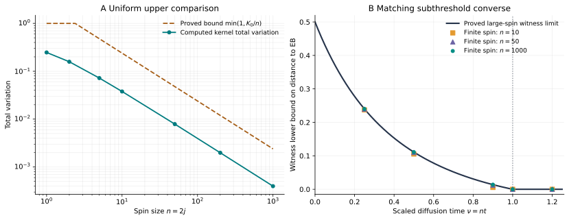
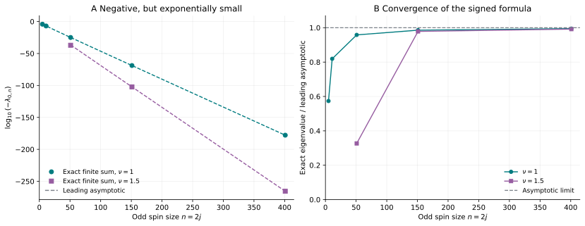

# Reproduce the finite checks

[Overview](../README.md) · [Scientific account](../science/README.md)

The repository's general statements are analytical. These checks compare independent formulas, fix normalization and indexing conventions, and test finite-spin behavior. They do not compute an optimized diamond distance, determine a quantum capacity, or replace the asymptotic proofs.

## Run

Use Python 3.11 or newer. The reference run records its exact interpreter and package versions in [the manifest](results/manifest.json); numerical dependencies are pinned in [requirements.txt](requirements.txt).

From the repository root:

```bash
python -m pip install -r verification/requirements.txt
python verification/run_all.py
python verification/make_figures.py
```

The runner prints one completion line for each check and ends with `"all_assertions_passed": true` if every assertion succeeds. Fresh reports go to `verification/local_results/`, which is ignored by Git. The figure generator uses the committed reference reports by default and writes two SVG figures under `figures/`.

To choose destinations or draw from a fresh run:

```bash
python verification/run_all.py --output-dir verification/local_results
python verification/make_figures.py --results-dir verification/local_results
```

Each check is also directly executable with `--output path/to/report.json`:

```bash
python verification/check_core.py
python verification/check_anisotropic.py
python verification/check_residual_npt.py
```

No network access, random seed, external data, quantum optimizer or arbitrary-precision package is required. The very small residual eigenvalues use Python's standard-library `decimal` arithmetic. Runtime depends on the machine; the reference manifest records the measured duration, and no wall-clock speed is part of a theorem.

## What is checked

| Module | Independent constructions | Registered finite cases |
|---|---|---|
| [Core](check_core.py) | Haar quadrature versus the exact Berezin multipliers; character sum versus Poisson images for heat; invariant Lindblad sectors for the Bell block | Seven kernel sizes through $n=1000$; 56 multipliers; four exact qubit cases; 25 Bell-sector cases |
| [Anisotropic](check_anisotropic.py) | Full sparse double-commutator generator versus the analytical tangent-plane witness limit | Four diffusion matrices, each at $n=16,32,64$, including longitudinal–transverse cross terms and rank-deficient noise |
| [Residual NPT](check_residual_npt.py) | Dense normalized Choi construction versus the singlet character sum; high-precision finite sum versus heat images minus the representation tail | 35 full-Choi cases through $n=9$ and 17 high-precision cases through $n=401$ |

### Core normalization and the complete-channel bound

The angle is the physical rotation angle $0\le\theta\le\pi$, and radial Haar density is $(2/\pi)\sin^2(\theta/2)$. The comparison is on SO(3), with conjugation removing the sign ambiguity of half-integer spin representations.

Integration uses $u=\theta/(2\sqrt t)$ and subdivisions near the probability peak. If the physical interval extends beyond $u=12$, the omitted mass is bounded explicitly using Maxwell domination. This prevents a shrinking peak from disappearing between fixed-angle quadrature points. SciPy's quadrature error estimate is reported separately from that analytical tail bound; it is not interval-arithmetic certification.

Every computed total variation lies below $K_0/n$, where $K_0=2.393520645\ldots$. For example:

| $n$ | Computed total variation | Analytical upper bound $K_0/n$ |
|---:|---:|---:|
| 5 | 0.0721153922 | 0.4787041290 |
| 50 | 0.0078792354 | 0.0478704129 |
| 1000 | 0.0003978740 | 0.0023935206 |

Total variation bounds the half-diamond distance to the explicit comparator. It is not asserted to equal that distance or the infimum over all EB channels. The registered Bell cases test the separate lower witness and its convergence, with the qubit closed form independently fixing the time normalization. [Analytical proof](../science/classicalization.md).

### Anisotropic witness

The sparse calculation evolves both population matrix units and both coherence matrix units independently. It checks the symmetry and Hermiticity of the selected partial-transpose block. For the four registered examples, the errors relative to the analytical limit decrease across the three sizes, and the final witnesses are negative. Those convergence assertions describe these samples; they do not assert monotonic convergence for every spin or diffusion matrix.

The cross-term example uses

```math
D=\begin{pmatrix}1&0.3&0.4\\0.3&2&0.2\\0.4&0.2&5\end{pmatrix}
```

with the coherent pole along the third coordinate. Thus the check exercises the derivation with longitudinal correlations, rather than assuming diagonal noise throughout. [Analytical proof and finite table](../science/anisotropic_diffusion.md).

### Exponentially small Choi eigenvalue

The dense construction exponentiates the Lindblad superoperator, reshapes it into a **normalized** Choi matrix, and then takes its partial transpose. It checks positivity and unit trace before comparing the singlet eigenpair with the scalar formula. This independently tests the factor $(n+1)^{-2}$ and the parity convention.

At larger $n$, ordinary floating-point subtraction can give a meaningless sign. The scalar checks use decimal precision $90+\lceil2n/\ln10\rceil$ for the registered $\nu<2$ cases. They compare the finite alternating sum with the separately evaluated Poisson heat term minus the omitted tail. After scaling by $n e^{-\nu n}$, the reconstruction errors are below $10^{-55}$, and the explicit tail-error bound passes in every registered case. The samples include $\nu=1,1.5,1.55,\pi/2$; the endpoint tests the positive asymptotic rather than assuming the negative sign persists there. [Analytical proof](../science/residual_entanglement.md).

## Recorded outputs

The [manifest](results/manifest.json) identifies a completed run. Its reports contain full values, tolerances and diagnostics:

- [Core checks](results/core.json)
- [Anisotropic checks](results/anisotropic.json)
- [Residual-entanglement checks](results/residual_npt.json)

The figures are generated from those reports by [make_figures.py](make_figures.py). No data points are hand edited. Dashed asymptotic curves are evaluated from the displayed analytical formulas.



The lower witness tends to a positive distance bound at every fixed $\nu<1$. Above the boundary, the finite witness may become zero before other entanglement witnesses do; the theorem concerns its limiting bound.



Only negative singlet values are plotted in the residual-entanglement figure; every retained point therefore certifies NPT. Its second panel plots the ratio to $-\beta(\nu)e^{-\nu n}/n$, with $\beta(\nu)=e^{-2\nu}/\cosh\nu$. The $n=11$, $\nu=1.5$ singlet value is positive and is omitted from this negative-eigenvalue plot; it remains in the numerical report. The statements concern this sector and do not determine the full PPT/EB boundary.
